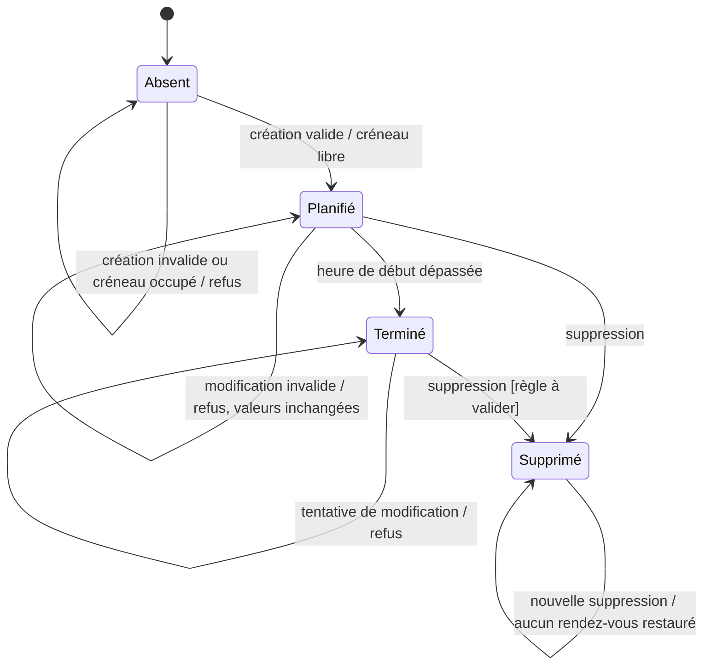

# Atelier test et validation des logiciels

## Livrable — Semaine 5

### Transitions d'état, cas d'utilisation, tests exploratoires et priorisation par les risques

**Application fil rouge :** gestion de rendez-vous d'un cabinet d'avocat  
**Niveau :** 3ᵉ année Licence — Technologies de l'Information  
**Entité métier :** rendez-vous

## 1. Périmètre et précautions

Le projet permet de créer, afficher, modifier et supprimer des rendez-vous. Le schéma SQL ne contient pas de champ de statut : un rendez-vous enregistré est présent dans la base, et une suppression l'efface. L'état « terminé » ci-dessous est donc un état métier dérivé du passage de l'heure de début, et non un statut effectivement stocké. Le diagramme est un modèle fonctionnel proposé pour concevoir les tests ; il ne prétend pas décrire un workflow de statuts déjà implémenté.

Les règles de modification d'un rendez-vous passé proviennent de l'exigence formulée en semaine 3. La règle temporelle de suppression n'étant pas définie, ce livrable ne considère pas la suppression d'un rendez-vous passé comme interdite. Toute règle métier proposée mais non spécifiée est marquée à valider.

## 2. Partie A — Diagramme d'états et transitions

### 2.1 États

- **Absent** : aucun rendez-vous correspondant n'est enregistré.
- **Planifié** : rendez-vous enregistré, dont l'heure de début n'est pas passée.
- **Terminé** : rendez-vous enregistré dont l'heure de début est passée ; état dérivé de la date et de l'heure du créneau.
- **Supprimé** : rendez-vous supprimé ; l'enregistrement n'existe plus. État terminal dans le modèle.

Le terme **Modifié** décrit l'événement et le résultat d'une action de modification : l'entité reste dans l'état Planifié, avec les nouvelles valeurs. Ce n'est pas un statut distinct.

### 2.2 Diagramme

### 2.3 Tableau des transitions

| État source | Événement / garde | État cible | Validité |
|---|---|---|---|
| Absent | Créer avec client reconnu, date future, créneau fixe libre et sujet valide | Planifié | Valide |
| Absent | Créer avec date invalide, client inconnu ou créneau indisponible | Absent | Refus attendu |
| Planifié | Modifier le sujet ou choisir une date/créneau futur disponible | Planifié (valeurs mises à jour) | Valide |
| Planifié | Modifier avec une date passée ou un créneau occupé | Planifié (valeurs inchangées) | Refus attendu |
| Planifié | L'heure de début du rendez-vous est dépassée | Terminé (dérivé) | Valide, automatique |
| Planifié | Supprimer le rendez-vous | Supprimé | Valide selon l'API existante |
| Terminé | Modifier le rendez-vous | Terminé (valeurs inchangées) | Interdite selon l'exigence de modification future |
| Supprimé | Modifier l'ancien identifiant de rendez-vous | Supprimé / enregistrement absent | Interdite |
| Supprimé | Supprimer à nouveau l'ancien identifiant | Supprimé / enregistrement absent | Pas de restauration ; règle de réponse API à préciser |
| Terminé | Supprimer le rendez-vous | Supprimé | À valider : aucune règle temporelle de suppression n'est définie |

## 3. Partie B — Cas de test des transitions

Utiliser une base de test isolée, un client connu et des rendez-vous préparés. « Heure future » et « heure passée » se réfèrent à l'heure de début du créneau, selon l'horloge de l'environnement.

| ID cas de test | Transition testée | Validité | État initial / action | Résultat attendu | Risque associé | Priorité |
|---|---|---|---|---|---|---|
| CT-W5-01 | Absent → Planifié | Valide | Aucun rendez-vous pour la date et le créneau ; soumettre une création avec client reconnu, date future et sujet valide. | Un rendez-vous est enregistré avec les valeurs soumises ; le créneau apparaît ensuite comme occupé. | Surbooking, création incorrecte (F03/F04) | Haute |
| CT-W5-02 | Planifié → Planifié (modifié) | Valide | Rendez-vous futur du client ; modifier le sujet et choisir un créneau libre pour une date future. | Les nouvelles valeurs sont enregistrées sur le même rendez-vous ; le nouvel historique reflète les valeurs mises à jour. | Modification incorrecte (F06) | Haute |
| CT-W5-03 | Planifié → Supprimé | Valide | Rendez-vous existant ; demander sa suppression. | Le rendez-vous n'apparaît plus dans l'historique et son créneau redevient disponible pour la date concernée. | Cohérence du planning (F03/F07) | Moyenne |
| CT-W5-04 | Planifié → Terminé | Valide, automatique | Rendez-vous enregistré dont l'heure de début passe pendant l'observation. | Le rendez-vous est considéré terminé selon la date et l'heure ; aucun changement manuel de statut n'est requis. | Validité temporelle (F04/F06) | Moyenne |
| CT-W5-05 | Terminé → Terminé par refus de modification | Interdite | Rendez-vous dont l'heure de début est passée ; tenter de modifier le sujet, la date ou le créneau. | La modification est refusée et les données du rendez-vous restent inchangées. | Modification d'un rendez-vous passé (F06) | Haute |
| CT-W5-06 | Supprimé → Supprimé par refus de modification | Interdite | Supprimer un rendez-vous puis tenter de modifier son ancien identifiant. | Aucun rendez-vous n'est recréé ; l'état reste absent de la base et de l'historique. La réponse doit signaler que l'opération n'a pas modifié de rendez-vous. | Intégrité de l'historique (F06/F07) | Moyenne |
| CT-W5-07 | Absent → Absent par refus de réservation en doublon | Interdite | Rendez-vous déjà enregistré pour la date et le créneau ; soumettre une seconde réservation sur le même couple. | La seconde création est refusée ; un seul rendez-vous existe pour le couple date-créneau. | Surbooking d'un créneau (F03/F04) | Haute |
| CT-W5-08 | Planifié → Planifié par refus de modification sur créneau occupé | Interdite | Rendez-vous futur ; tenter de le déplacer vers un créneau déjà pris à la date choisie. | La modification est refusée ; les anciennes valeurs et la réservation préexistante restent inchangées. | Modification incorrecte / surbooking (F06/F04) | Haute |

## 4. Partie C — Cas d'utilisation « Réserver un créneau »

### Acteur

Client identifié par une référence existante.

### Préconditions

- Le client possède une référence reconnue.
- La date souhaitée est future.
- Un créneau fixe est disponible pour cette date.

### Scénario principal

1. Le client ouvre le formulaire de réservation.
2. Il sélectionne une date future.
3. Le système présente les créneaux libres parmi les cinq horaires autorisés.
4. Le client choisit un créneau et saisit le sujet du rendez-vous.
5. Le client confirme la réservation.
6. Le système vérifie de nouveau le client, la date et la disponibilité du créneau.
7. Le système enregistre le rendez-vous et confirme la création.
8. Le rendez-vous apparaît dans l'historique du client et le créneau n'est plus proposé pour cette date.

### Extension — le créneau a été réservé entre-temps

- **Étape 6a :** le système constate que le créneau choisi n'est plus libre.
- **Étape 7a :** il refuse la création sans enregistrer de doublon.
- **Étape 8a :** il informe le client et lui permet de choisir un autre créneau disponible.

## 5. Partie D — Charte de test exploratoire

| Élément | Définition |
|---|---|
| **Mission** | Explorer si la consultation des disponibilités et la réservation restent cohérentes lorsque l'utilisateur change plusieurs fois de date, sélectionne un créneau puis revient en arrière ou soumet plusieurs fois le formulaire. Question directrice : peut-on créer un rendez-vous sur un créneau déjà pris ou afficher une disponibilité périmée ? |
| **Durée** | 30 minutes |
| **Zone testée** | Formulaire de réservation, consultation des créneaux disponibles, création du rendez-vous et vérification de l'historique. |
| **Données** | Compte de test connu ; dates de test distinctes ; au moins un créneau libre et un créneau occupé ; aucune donnée réelle. |
| **Approche** | Varier les dates, revenir à une date précédente, rafraîchir la liste, ouvrir deux sessions de test si disponibles, soumettre une fois puis plusieurs fois, et vérifier l'état persistant en base et dans l'historique. |
| **Notes et résultats** | Pour chaque exploration, noter les étapes, les données, le résultat observé, le résultat attendu, les captures ou identifiants utiles et toute anomalie reproductible. Ne pas modifier les données hors du jeu de test. |
| **Critère d'arrêt** | À 30 minutes ; arrêter également si l'environnement ou les données de test ne permettent plus de garantir l'absence d'impact sur des données réelles. Consigner les pistes non explorées. |

## 6. Priorisation par les risques

La priorisation reprend les risques et fonctions critiques identifiés dans le README du projet : surbooking (F03/F04), créneau invalide (F03/F04/F08), date passée ou invalide (F04/F06), modification incorrecte (F06) et suppression (F07). La création, la disponibilité, la vérification du client, la modification et les créneaux fixes sont identifiés comme fonctions critiques ; les cas qui les couvrent passent en priorité haute. Les cas de suppression ou de transition automatique sont classés moyens, en cohérence avec leur impact sur la cohérence du planning, mais restent à exécuter.

| Cas de test | Risque associé (semaine 1) | Priorité |
|---|---|---|
| CT-W5-01 | Surbooking / échec de création (F03/F04) | Haute |
| CT-W5-02 | Modification incorrecte du rendez-vous (F06) | Haute |
| CT-W5-03 | Suppression non répercutée dans l'historique ou les disponibilités (F03/F07) | Moyenne |
| CT-W5-04 | Mauvaise interprétation temporelle du rendez-vous (F04/F06) | Moyenne |
| CT-W5-05 | Modification autorisée après l'heure du rendez-vous (F06) | Haute |
| CT-W5-06 | Opération de modification sur un rendez-vous supprimé (F06/F07) | Moyenne |
| CT-W5-07 | Surbooking d'un créneau (F03/F04) | Haute |
| CT-W5-08 | Modification entraînant un conflit de créneau (F06/F04) | Haute |

## 7. Points à confirmer avant l'exécution

- Le modèle du projet n'enregistre aucun statut de rendez-vous ; le statut terminé est calculé à partir de la date et de l'heure. Confirmer si un historique de statuts ou une confirmation explicite est attendu.
- Le code de suppression efface l'enregistrement. Confirmer si une suppression logique (annulation conservée dans l'historique) est attendue à la place.
- Confirmer si la suppression d'un rendez-vous passé est permise.
- Définir la frontière exacte de la transition vers « Terminé » et le fuseau horaire de référence.
- Le flux de modification de l'interface semble incomplet ; distinguer les tests de l'exigence attendue des observations de l'implémentation actuelle.

